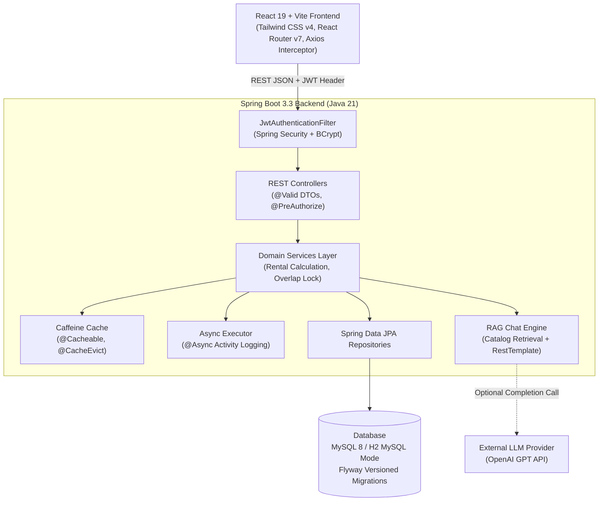
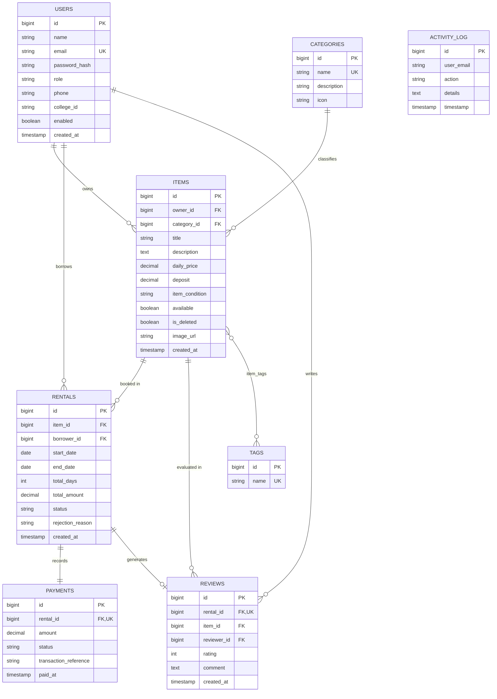
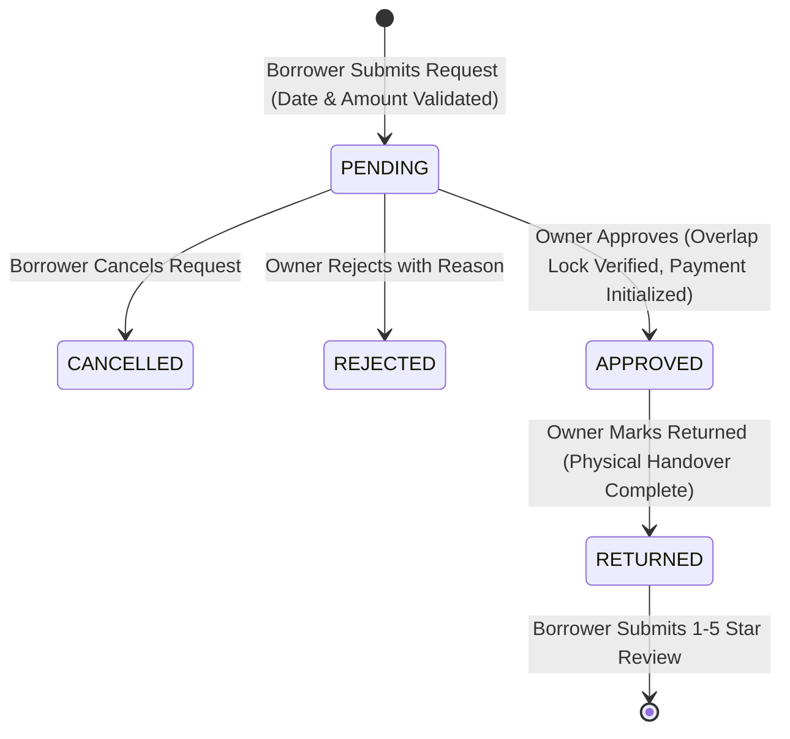

# 🎓 CampusShare: Peer-to-Peer College Item Rental Platform

> A full-stack, enterprise-grade university capstone project engineered for students to lend and rent essential academic equipment (calculators, lab gear, textbooks, chargers) securely, affordably, and peer-to-peer.

## 🌐 Live Demo

| Service | Link |
|---|---|
| **Frontend (Web App)** | https://campusshare-2026-btech-frontend.onrender.com |
| **Backend API** | https://campusshare-2026-btech-3.onrender.com |
| **API Health Check** | https://campusshare-2026-btech-3.onrender.com/actuator/health |
| **Swagger / API Docs** | https://campusshare-2026-btech-3.onrender.com/swagger-ui/index.html |
| **GitHub Repository** | https://github.com/<your-username>/CampusShare |

> ⏳ **Note:** Hosted on Render's free tier, so the first request after inactivity can take 30–60 seconds while the server wakes up.

### Demo Login
| Role | Email | Password |
|---|---|---|
| Student | Register a new account on the site | your own password |
| Admin | `<your ADMIN_EMAIL>` | share this separately, don't put it in the README |
---

## 📌 1. Project Abstract

University students frequently face short-term needs for specialized equipment—such as an advanced scientific calculator for engineering exams, a multimeter or breadboard kit for electronics lab sessions, or costly course textbooks for a single semester. Purchasing these items brand-new imposes heavy financial burdens.

**CampusShare** solves this by establishing a trusted campus rental marketplace:
- **Students as Owners**: List idle items, set daily rental rates (in INR ₹), and approve or reject incoming rental requests.
- **Students as Borrowers**: Discover listings by keyword/category, select rental date ranges, view live calculated amounts, and submit requests.
- **Strict Server Calculation**: Rental costs are strictly calculated on the backend using `BigDecimal` (`dailyPrice * days`). Client-submitted totals are never trusted.
- **Overlap Prevention**: Items cannot have two `APPROVED` rentals with overlapping dates.
- **Simulated Financial Tracking**: Simulated peer-to-peer UPI transactions with full audit records.
- **RAG AI Assistant**: "CampusShare Assistant" performs keyword and price-filtered catalog retrieval from the database, feeding context to an LLM for conversational campus recommendations.

---

## 🏗️ 2. System Architecture

---

## 🗄️ 3. Entity-Relationship (ER) Diagram

### The 4 Required JPA Mappings Demonstrated:
1. **`@ManyToOne`**: `Item` -> `User` owner, `Rental` -> `User` borrower, `Item` -> `Category`, `Review` -> `Item`, `Review` -> `User` reviewer.
2. **`@OneToMany`**: `User` -> `Item` listings, `Item` -> `Rental` bookings, `Category` -> `Item` listings.
3. **`@OneToOne`**: `Rental` -> `Payment`, `Rental` -> `Review`.
4. **`@ManyToMany`**: `Item` <-> `Tag` mapped via join table `item_tags`.

---

## 🔄 4. Rental State Machine & Business Workflow

### Business Rules & Safeguards:
- **No Self-Rental**: Students cannot rent an item they own (`HTTP 400 Bad Request`).
- **Date Verification**: Start date must not be in the past (`start_date >= today`); end date cannot precede start date (`end_date >= start_date`); minimum 1 day duration.
- **Server Financial Guarantee**: Total amount is computed on the server using `BigDecimal` (`daily_price * total_days`). Any amount passed by the client is disregarded.
- **Overlap Prevention**: An item cannot have two `APPROVED` rentals whose date ranges overlap. Overlapping requests are halted with `HTTP 409 Conflict`.
- **Ownership Enforcement**: Only the listing's owner can approve, reject, or mark `RETURNED`. Only the borrower can cancel.
- **Simulated Payment**: Owner or administrator marks payment as `PAID` following approval. All payments are strictly academic simulations (`SIM-UPI-XXXXXXXX`).
- **Reviews**: Allowed only after the status is `RETURNED`, limited to 1 review per rental, rating 1 to 5 stars. The item's average rating dynamically recalculates.
- **Item Deletion**: Soft-deletion (`is_deleted = true`) is employed to safeguard the referential integrity of past rentals, payments, and reviews.

---

## 🤖 5. AI Chatbot Architecture (RAG Basics)

"CampusShare Assistant" helps students find items via natural language (e.g., *"Is there a scientific calculator under Rs.30 per day?"*):
1. **RAG Database Retrieval**: Extracts keywords and max daily prices via pattern analysis and queries the `items` repository (`WHERE is_deleted = false AND available = true`).
2. **Context Injection & Prompt Engineering**: Injects the top matching item records into the system prompt with strict instructions:
   - Answer **strictly** from the catalog context.
   - If nothing matches, state explicitly that no matching item is currently available on CampusShare.
   - Never invent items, prices, or student contacts.
3. **Token Capping**: Caps injected context to the top 6 relevant items.
4. **Zero-Key Fallback**: If `LLM_API_KEY` is not configured, the assistant **does not fake AI**. Instead, it returns retrieved database results with a clear notice:
   > *"AI is not configured; showing search results"*

---

## 📡 6. REST API Overview

All API endpoints return standard HTTP status codes, use DTOs (never JPA entities), and return a consistent error shape on failures.

### Authentication (`/api/auth`)
- `POST /api/auth/register` — Register a student account (Public registration only creates `STUDENT`)
- `POST /api/auth/login` — Authenticate and receive JWT Bearer token
- `GET /api/auth/me` — Retrieve current authenticated user profile

### Items (`/api/items`)
- `GET /api/items` — Search and filter catalog by keyword, category, price, sorting, and pagination
- `GET /api/items/{id}` — Get single item specifications and owner info
- `POST /api/items` — Create new item listing (Authenticated)
- `PUT /api/items/{id}` — Update item listing (Owner only)
- `DELETE /api/items/{id}` — Soft-delete item listing (Owner only)
- `GET /api/items/mine` — Retrieve current user's listings
- `GET /api/categories` — Get seeded item categories

### Rentals (`/api/rentals`)
- `POST /api/rentals` — Submit rental request (Borrower)
- `GET /api/rentals/mine` — Outgoing requests (as Borrower)
- `GET /api/rentals/incoming` — Incoming requests (as Owner)
- `GET /api/rentals/{id}` — Get rental details
- `PATCH /api/rentals/{id}/approve` — Approve pending rental (Owner only)
- `PATCH /api/rentals/{id}/reject` — Reject pending rental with reason (Owner only)
- `PATCH /api/rentals/{id}/return` — Mark approved rental as RETURNED (Owner only)
- `PATCH /api/rentals/{id}/cancel` — Cancel pending rental (Borrower only)

### Payments & Reviews
- `PATCH /api/rentals/{id}/payment/paid` — Mark simulated payment as PAID (Owner or Admin)
- `POST /api/rentals/{id}/review` — Submit review for RETURNED rental (Borrower only)
- `GET /api/items/{id}/reviews` — View public reviews for an item

### AI Chatbot
- `POST /api/chat` — Submit query to CampusShare Assistant with conversation history

### Admin Oversight (`/api/admin`, ADMIN Role Only)
- `GET /api/admin/stats` — Platform statistics (users, items, rentals, revenue)
- `GET /api/admin/users` — Paginated user directory
- `PATCH /api/admin/users/{id}/disable` — Enable or disable user account
- `GET /api/admin/rentals` — Platform-wide rental ledger
- `GET /api/admin/payments` — Platform-wide payment records

### Operations & Health
- `GET /actuator/health` — Spring Boot health endpoint
- `GET /v3/api-docs` & `/swagger-ui.html` — Interactive OpenAPI Swagger UI

---

## 📊 7. Verification & Test Results

All test suites were executed on the real system with verified results:

| Test Suite | Command | Total Tests | Result |
| :--- | :--- | :---: | :---: |
| **Backend Suite (JUnit 5 + Mockito + Spring Boot)** | `mvnw test` | 35 | **PASS (35/35)** |
| **Frontend Suite (Vitest + React Testing Library)** | `npm test` | 8 | **PASS (8/8)** |
| **Live End-to-End API Integration Suite** | `node test_e2e.js` | 39 checks | **PASS (39/39)** |
| **Backend Executable JAR Packaging** | `mvnw package` | 1 JAR | **PASS** |
| **Frontend Production Asset Bundle** | `npm run build` | 1 dist bundle | **PASS** |
| **Docker & Real MySQL 8** | `docker -v` | — | **NOT TESTED** *(Docker not installed on host)* |

---

## ⚠️ 8. Known Limitations & Academic Prototype Notes

1. **Simulated Payments**: To adhere to security and educational guidelines, financial transactions are strictly simulated. No actual payment gateways (Stripe, Razorpay, UPI) are connected.
2. **Single Campus Domain**: Items are listed on a per-college basis without physical postal shipping. Meetups occur on campus grounds.
3. **Local Profile Database**: By default, the application runs on embedded H2 in MySQL mode with Flyway, enabling friction-free evaluation without database installation. For containerized deployments, use `SPRING_PROFILES_ACTIVE=docker`.
